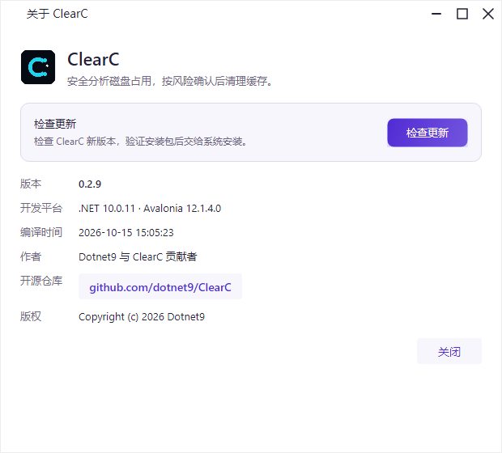

# ClearC 0.2.9 界面与行为验收

本机基线为 Windows x64、1060 × 700、简体中文与英文；CodeWF.Avalonia 12.1.4.20、CodeWF.Toolkit 1.0.0.19。主界面沿用磁盘总览、结果清单、日志与状态栏的产品结构，标题栏统一三态主题、八配色圆点及配色选择、语言选择。

## 可复现命令

```powershell
dotnet test ClearC.slnx -c Release
pwsh scripts/sync_localization_keys.ps1 -Check
pwsh scripts/build_standalone_prototype.ps1 -Check
npm ci --prefix design/tests
# 首次运行需要安装浏览器：在 design/tests 目录执行 npx playwright install chromium。
npm test --prefix design/tests
dotnet run --project scripts/ui-verification/UiVerification.csproj -c Release -- artifacts/ui-managed
node design/tests/compare-layout.cjs artifacts/ui-managed artifacts/prototype-audit
pwsh scripts/publish.ps1 -RuntimeIdentifiers win-x64
```

独立验证器使用 Headless 平台与真实 Skia 渲染，不创建系统窗口，不占用鼠标键盘；正式程序的 `--selfcheck` 默认使用系统窗口平台，锁屏环境应使用独立验证器。NativeAOT 验证器编译及运行命令见 [发布流程](RELEASE.md)。

## 覆盖范围

- 核心及桌面测试共 196 项（中文格式化测试显式指定全局语言，避免英文 CI 默认语言改变预期），包含风险选择、路径约束、清理白名单、Windows 命令解析、日志脱敏、取消与状态流转。
- 原型将唯一 HTML 复制到空目录并阻断外部资源，遍历两语言 × 八配色 × 明暗共 32 组合，检查同窗切语、偏好恢复、六个工作流视图、勾选、右键、取消、确认、日志导出、关于及六种更新状态；禁止脚本错误及英文界面残留中文。
- 应用验证器输出 44 张真实视图 PNG 及对应坐标：32 张外观与语言组合、2 张双语关于窗口、10 张双语扫描／结果／确认／清理／完成状态。
- 验证同一窗口切语后主题、配色和语言选项不丢失，未提权提示随语言更新；检查偏好 JSON 实际落盘、重新加载及系统模式保存。
- 扫描和清理由受控服务驱动实际 ViewModel 与 AXAML；真实目录大小计算仅使用隔离样例目录。更新检查覆盖发现版本、下载、安装与退出请求、失败、最新、检查取消、下载取消及无匹配资产跳转；不下载或执行真实安装器。

宿主 JSON 输出到 I18n，T4 生成强类型键；库文案通过 NuGet 内嵌并共享唯一全局实例。macOS 安装包的宿主翻译从 `Contents/Resources/I18n` 加载。

## 原型与实现对照

42 个主窗口及工作流视图分别量测窗口、工作区、磁盘环图、结果列表、日志和状态栏六个区域，共 **1008 个坐标与尺寸值**，容差 2 DIP。本机受控基线中，窗口为 `(0,0,1060,700)`，工作区为 `(1,45,1058,466)`，环图为 `(27,61,132,132)`，日志为 `(1,511,1058,160)`。

这项检查只覆盖列出的区域，不代表整页像素相似率。标题栏选择框宽度、环图、Hero 字号与行高、扫描筛选栏和空态裁切已逐项修正；浏览器与 Semi 原生输入控件的边框、字体度量、窗口按钮及动画笔触仍存在差异。原型使用 21 个可交互样例，原生工作流使用 3 个受控任务，不把样例行数和内容差异计作布局缺陷。




## 平台与人工验收边界

Windows x64 正式 NativeAOT 发布成功；独立原生验证器编译及实际运行成功，退出码 0，生成 44 张 PNG，原生与原型 1008 项坐标对照通过。README 的静态图及动画来自此次原生输出。五平台 CI 均原生编译并执行离屏验证器，安装器另行打包并验证 SHA-256。Semi、Ursa 与 Reactive 的裁剪／AOT 分析告警保持可见。

ClearC 的实际扫描、提权和清理只支持 Windows；Linux/macOS 验证器检查 34 张外观及关于视图、偏好、更新和隔离目录计算，跳过仅适用于 Windows 的清理目标与工作流。相应安装包验证构建与分发结构，正式程序在这些平台提示后以退出码 2 结束，不代表已支持跨平台清理。锁屏期间未执行人工桌面验收，多 DPI、跨屏、窗口拖动、文件选择器、管理员重启和实际安装器交互仍需在可用桌面及目标系统验证。
